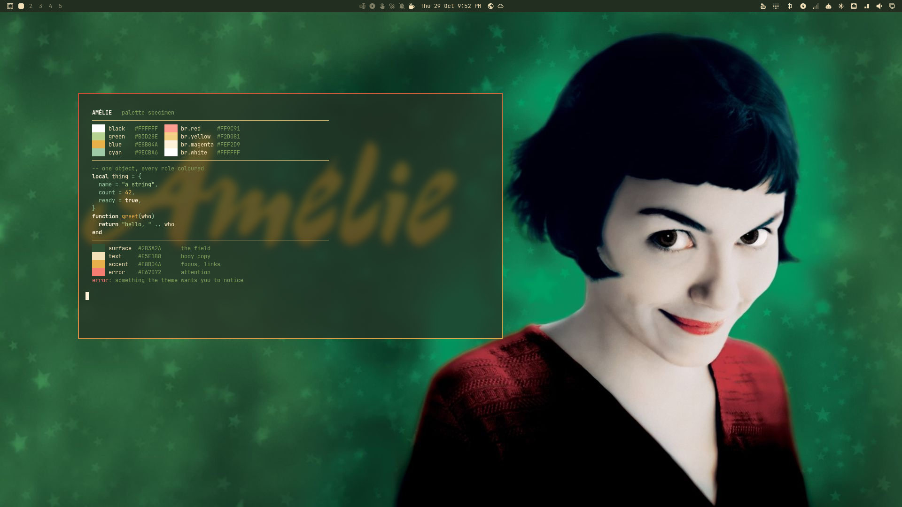

# Amélie



A theme built from the Amélie palette: onyx green field, wheat light, brass
chrome, and the red of the café awning. The red is kept for the one thing that
should be noticed: errors, attention marks and the active window border.

## Install

```bash
omarchy theme install https://github.com/Binz120/omarchy-amelie-theme
omarchy theme set amelie
```

A clone installs as `amelie` — the accented slug is a local name, since a
repository name cannot carry it — and Omarchy drops a cloned theme's
`hyprland.lua` and the terminal configs at staging, because those run code.
`colors.toml` carries the same border gradient as a string, so the look
survives; the files a local copy adds are a gradient on grouped windows and
opacity in the terminals.

## Apply

The theme lives in `~/.config/omarchy/themes/amélie`, written by hand, so
nothing is stripped at staging.

```
omarchy theme set amélie
```

Backgrounds: `Super + Ctrl + Space` or `omarchy theme bg next`.

## Palette

Twelve of the anchors arrived as a list and are used directly; the rest are OKLCH
variants of those anchors — same hue, different lightness and chroma — because a
dark theme cannot print `#A4161A` as text (1.56:1) and stay readable.

| Role | Colour | Anchor | Contrast on the field |
|---|---|---|---|
| Field (background) | `#2B3A2A` | Onyx | — |
| Panels (dark background) | `#212E20` | Onyx L 0.285 | — |
| Deepest chrome | `#182417` | Onyx L 0.245 | — |
| Body text (foreground) | `#F5E1B8` | Wheat Light | 9.39 |
| Cursor (bright foreground) | `#FFF9EA` | Wheat Light L 0.985 | 11.48 |
| Dim text (dark foreground) | `#76914C` | Green Olive L 0.62 | 3.40 |
| Comments (muted) | `#839D5C` | Green Olive L 0.66 | 3.99 |
| Accent — focus, links, functions | `#E8B04A` | Honey | 6.17 |
| Selection | `#2E5B34` | Military Green | 6.14 with wheat on it |
| Keywords | `#FEF2D9` | Wheat L 0.965 | 10.86 |
| Types | `#E8C87E` | Caramel L 0.845 | 7.46 |
| Numbers | `#E9C46A` | Saffron | 7.22 |
| Strings | `#B5D28E` | Green Olive L 0.825 | 7.22 |
| Parameters, properties | `#9ECBA6` | Military Green L 0.80 | 6.63 |
| Errors, deletions | `#F67D72` | Red Ruby L 0.725 | 4.65 |
| ANSI magenta | `#E4887A` | Rust L 0.72 | 4.65 |
| ANSI brown | `#885E41` | Black of Jay L 0.52 | 2.14 (unused slot) |

Reds never carry body text below the error role. `#D64933` (vermillon) and
`#D64933`-adjacent values sit at 2.79:1 on the field, so they are used as
surfaces and as the border gradient stop, not as type. Comments are the one
deliberately low-contrast role (3.99, chrome only); everything else clears 4.5.

Two notes on the source list. `#C1C13` (red blood), `#F7A3A` (green forest) and
`#CC86E` (green pistachio) are five digits — not valid hex — so those three roles
were derived instead: blood as a lifted ruby, pistachio as a lifted olive, forest
as the military-green hue carried into the sage family. Send the full six digits
and they replace the derivations exactly.

## The border

`hyprland.lua` sets a two-stop gradient, vermillon to honey at 45°, on
`general.col.active_border` and on grouped windows:

```lua
local active_border_color = { colors = { "rgba(d64933ee)", "rgba(e8b04aee)" }, angle = 45 }
```

`colors.toml` carries the same gradient as a string so a copy installed from a
repo (which loses `*.lua`) still gets a border, just a single-stop one.

## Files

| File | What it does |
|---|---|
| `colors.toml` | The palette; every other app config is generated from it at staging. |
| `shell.toml` | The bar two steps darker than the windows, awning gradient on popups, menus and notifications. |
| `hyprland.lua` | The active-window gradient. |
| `gtk.css` | GTK3/4 and libadwaita sheet: Lora on titles, menus and headerbars, sans body. |
| `alacritty.toml`, `foot.ini`, `kitty.conf`, `ghostty.conf` | Colour and opacity only. |
| `btop.theme` | Graphs warm from green to brass as they rise; heat burns honey-white. |
| `icons.theme` | `Yaru-sage-dark`. |
| `fastfetch.jsonc` | fastfetch layout in the theme palette: logo, hardware / software / age sections drawn in olive rules, keys in sage, honey and rust. Picked up by `hooks/theme-set.d/30-fastfetch`. |
| `starship.toml`, `lazygit.yml`, `fzf.sh` | Prompt, git TUI and fuzzy finder colours; all three are wired automatically by `hooks/theme-set.d/40-app-configs`. |
| `mako.ini` | Notification daemon: onyx box, honey border, critical notifications in ruby. Include it from `~/.config/mako/config`. |
| `swayosd.css` | OSD styling: `swayosd-server --style ~/.local/state/omarchy/current/theme/swayosd.css`. |
| `walker.css` | Launcher: point `~/.config/walker/config.toml` at this file. |
| `zed.json`, `warp.yaml`, `vencord.theme.css` | Editor, terminal and Discord themes — each app imports its file by hand (see below). |
| `base24.yaml` | The palette in Base24 form, for any tool that consumes that spec. |
| `chromium.theme` | `43,58,42`. |
| `backgrounds/` | One wallpaper, generated procedurally from the palette (Pillow + numpy, 2560x1440). |
| `preview.png` | 1920x1080 capture on a virtual output. |

## Apps outside Omarchy's own theming

Omarchy generates terminals, Neovim, Helix, VS Code, Obsidian, fcitx5, the shell,
the AI CLIs and GTK from `colors.toml`, so this theme does not repeat them. The
files above cover the apps that read a user-level config of their own.

Wired automatically on every `omarchy theme set` by `40-app-configs`:

| App | What happens |
|---|---|
| lazygit | `~/.config/lazygit/config.yml` links to the active theme's `lazygit.yml` |
| starship | `~/.config/starship.toml` links to the active theme's `starship.toml` |
| fzf | `~/.config/fzf/omarchy-theme.sh` is rewritten; source it once from your shell rc |

Imported by hand, because the app owns the file:

```bash
# mako — add to ~/.config/mako/config
include=~/.local/state/omarchy/current/theme/mako.ini

# swayosd
swayosd-server --style ~/.local/state/omarchy/current/theme/swayosd.css

# walker — ~/.config/walker/config.toml
[ui]
theme = "~/.local/state/omarchy/current/theme/walker.css"

# Zed — copy into ~/.config/zed/themes/ and pick "Amélie"
cp ~/.local/state/omarchy/current/theme/zed.json ~/.config/zed/themes/

# Warp — copy into ~/.warp/themes/
mkdir -p ~/.warp/themes && cp ~/.local/state/omarchy/current/theme/warp.yaml ~/.warp/themes/

# Vencord / Vesktop — copy into the themes folder and enable it in settings
cp ~/.local/state/omarchy/current/theme/vencord.theme.css ~/.config/Vencord/themes/
```

Steam is not covered: neither Omarchy nor Steam exposes a palette hook that a
theme can write, so a `steam.css` here would be decoration. Waybar and Wofi are
Omarchy 3.8 only and are deliberately absent.

## Backgrounds

| File | Motif |
|---|---|
| `1.jpg` | Night interior: brass bokeh above, the red awning below, `CAFÉ DES DEUX MOULINS` tracked in the corner. |

## Waterfox

Waterfox is Firefox-derived, so it reads `userChrome.css` and not a single
colour value. Omarchy themes Chromium only, which is why the browser looks stock
on a fresh theme change. This machine has a hook for it:

```
~/.config/omarchy/hooks/theme-set.d/20-waterfox      # runs on every theme change
~/.local/bin/omarchy-waterfox-theme [slug] [--dry-run]  # renders the CSS by hand
```

It writes `userChrome.css` and `userContent.css` into every Waterfox profile that
has a `prefs.js`, and appends the four prefs that let chrome stylesheets load:
`toolkit.legacyUserProfileCustomizations.stylesheets`, both `browser.theme.*`
prefs, and `ui.systemUsesDarkTheme`. Waterfox reads the CSS at startup — quit and
reopen it after a theme change.

## Verified

```
omarchy theme set amélie   → staged, 37 files
grep -rl '{{' …                  → no unresolved templates
hyprctl configerrors             → empty
general:col.active_border        → eed64933 eee8b04a 45deg
omarchy-theme-color --all | wc -l→ 58 tokens
contrast_audit.py                → all text roles ≥ 4.5 except muted (3.99, chrome only)
```
